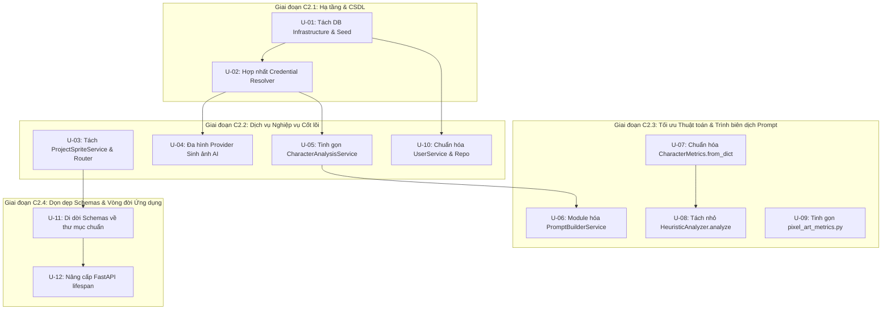

# BÁO CÁO ĐÁNH GIÁ CODE SMELL BACKEND (GIAI ĐOẠN C1)
**Dự án:** Sprite Normalizer & AI Studio  
**Giai đoạn:** C1 – Backend Code Smell Assessment  
**Thời điểm lập:** 2026-11-15  
**Cơ sở đối chiếu:** Baseline C0 (`docs/refactoring/C0_BACKEND_BASELINE.md`), Git commit `b6a9c50`, và 37 unit tests hiện hành (100% pass).  
**Mục tiêu:** Nhận diện toàn diện các vấn đề chất lượng code (Code Smells), vi phạm nguyên lý thiết kế (SOLID/Clean Architecture), độ phức tạp thuật toán và trùng lặp logic; từ đó đề xuất các kỹ thuật tái cấu trúc an toàn, chia nhỏ thành các đơn vị refactor độc lập sẵn sàng thực thi ở Giai đoạn C2.

---

## 1. TỔNG QUAN VÀ PHƯƠNG PHÁP LUẬN ĐÁNH GIÁ

Quá trình đánh giá được thực hiện trên toàn bộ 38 tệp mã nguồn Python trong `backend/` thông qua phân tích cú pháp tĩnh AST (Abstract Syntax Tree), đo lường độ phức tạp chu trình (Cyclomatic Complexity), độ sâu lồng nhánh (Nesting Depth), ranh giới trách nhiệm kiến trúc (SRP & SoC), và đối chiếu với baseline đầu ra C0.

> [!IMPORTANT]
> **Nguyên tắc định hướng:**
> - Số dòng code (LOC) chỉ đóng vai trò là dấu hiệu trực quan ban đầu để khoanh vùng kiểm tra, **tuyệt đối không phải là căn cứ duy nhất** để kết luận Code Smell.
> - Ưu tiên các kỹ thuật refactoring cơ bản, trực diện và an toàn: *Extract Function, Extract Class, Extract Module, Move Function, Guard Clauses*.
> - **Không áp dụng Design Patterns phức tạp** nếu giải pháp hướng thủ tục hoặc hàm thuần túy đơn giản hơn đã giải quyết triệt để vấn đề (Tuân thủ KISS, YAGNI).
> - **Không chỉnh sửa bất kỳ dòng mã nguồn nào** trong giai đoạn đánh giá này.

---

## 2. BẢNG TỔNG HỢP CÁC CODE SMELL CỐT LÕI ĐƯỢC PHÁT HIỆN

| Mã Smell | Vị trí chính | Mức độ | Nhóm Smell | Tóm tắt vấn đề |
| :--- | :--- | :---: | :--- | :--- |
| **SM-01** | `backend/db.py` | **CRITICAL** | God Module / Mixed Concerns / Global Side-Effect | Trộn lẫn cấu hình kết nối DB, DDL schema migration động và seed tài khoản kiểm thử; tự động chạy DDL/Seed ngay khi import module. |
| **SM-02** | `backend/api/v1/sprites.py` | **HIGH** | SRP Violation / Layer Bypassing | Gộp chung tuyến xử lý ảnh thuật toán không trạng thái với CRUD MySQL có trạng thái; Router gọi trực tiếp Repository bỏ qua Service layer. |
| **SM-03** | `backend/services/user_service.py` | **HIGH** | SoC Violation / Security Smell | Service tự viết và thực thi SQL thuần chèn/sửa bảng users; xác thực tài khoản cứng (hardcoded logic); mật khẩu lưu và so khớp dạng thô (plaintext). |
| **SM-04** | `backend/services/image_gen_service.py` | **HIGH** | Abstraction Leak / High Cognitive Complexity | Không sử dụng tầng `BaseAiProvider`/`AiProviderFactory`; tự gọi HTTP `requests.post` thô với 6 tầng lồng nhau và xử lý mã lỗi rải rác. |
| **SM-05** | Nhiều file (`character_analysis.py`, `image_gen_service.py`, `prompt_service.py`) | **MEDIUM** | Duplicated Code (DRY Violation) | Trùng lặp logic bóc tách API Key/Provider hiệu dụng (4 nơi) và kiểm tra cờ `ai_enabled` của dự án (5 nơi). |
| **SM-06** | `backend/core/metrics/pixel_art_metrics.py` | **MEDIUM** | Long Method / High Cyclomatic Complexity | Các hàm `analyze_ramps` (126 dòng, 37 nhánh), `analyze_outline` (85 dòng, 18 nhánh) chứa logic thuật toán quá dài và lồng sâu. |
| **SM-07** | `backend/services/character/prompt_builder_service.py` | **MEDIUM** | Long Method / Hardcoded Data Dumps | `build_default_frame_actions` (185 dòng) và `compile_sprite_sheet_prompt` (154 dòng, 27 nhánh) chứa từ điển hardcode khổng lồ và xử lý chuỗi phức hợp. |
| **SM-08** | `backend/services/character/prompt_service.py` | **MEDIUM** | Manual Data Mapping / Duplication | Tự bóc tách 38 trường dictionary bằng tay để tái tạo `CharacterMetrics` thay vì có phương thức chuyển đổi chuẩn. |
| **SM-09** | `backend/api/v1/` và `backend/schemas/` | **LOW** | Scattered DTOs / Unused Schemas | Định nghĩa Request DTOs ngay trong file router (`projects.py`, `character_analysis.py`, `auth.py`) trong khi thư mục `schemas/` đã có sẵn. |
| **SM-10** | `backend/repositories/project_repository.py` | **MEDIUM** | Brittle Cascading / Swallowed Exceptions | Thực hiện xóa thủ công nối tiếp qua 6 bảng CSDL với khối `try...except Exception: pass` nuốt lỗi im lặng thay vì dựa vào ràng buộc CSDL. |
| **SM-11** | `backend/repositories/testbed_repository.py` | **LOW** | Multi-Entity God Repository | Một repository quản lý 3 thực thể độc lập (`testbed_maps`, `testbed_characters`, `testbed_character_frames`), phá vỡ tính nhất quán của BaseRepository. |
| **SM-12** | `backend/main.py` | **LOW** | Deprecated Framework Lifecycle | Sử dụng cú pháp `@app.on_event("startup")` đã lỗi thời trong FastAPI / Starlette thay vì `lifespan` context manager. |

---

## 3. PHÂN TÍCH CHI TIẾT TỪNG NHÓM CODE SMELL

### 3.1 Nhóm 1: God Module & Tác dụng phụ toàn cục (`backend/db.py`)
- **Triệu chứng:**
  - `init_db()` kéo dài 173 dòng code, 24 nhánh rẽ nhánh, độ sâu lồng nhánh tối đa đạt cấp độ 7.
  - Trộn lẫn 3 trách nhiệm hoàn toàn khác nhau vào một tệp hạ tầng:
    1. *Cấu hình kết nối:* Khởi tạo Engine, SessionLocal, Dependency `get_db`.
    2. *Schema Migration:* Các hàm `ensure_project_columns`, `ensure_preset_columns`, `ensure_user_columns` chạy `ALTER TABLE` khi bảng đã tồn tại.
    3. *Data Seeding:* Chèn tài khoản Admin (`id=1`, mật khẩu `'1'`), tài khoản test `origin@gmail.com` (`id=2`, mật khẩu `'123456'`), tự ý xóa/hoán đổi ID người dùng nếu bị chiếm (`DELETE FROM users WHERE id = 2`).
  - **Tác dụng phụ (Side-effect):** Dòng 291-294 gọi trực tiếp `init_db()` ở phạm vi module. Chỉ cần một unit test hoặc script phụ trợ import bất kỳ thứ gì liên quan đến `backend.db` là mã nguồn sẽ cố gắng kết nối MySQL và chạy migration/seed. Chưa kể `main.py` lại gọi `init_db()` lần nữa khi khởi động (chạy 2 lần).
- **Hậu quả:** Gây chậm trễ khi nạp ứng dụng, tiềm ẩn rủi ro phá hủy dữ liệu kiểm thử, khó mock kết nối CSDL trong môi trường kiểm thử tự động độc lập.

### 3.2 Nhóm 2: Vi phạm SRP & Trộn lẫn Trách nhiệm Router (`backend/api/v1/sprites.py`)
- **Triệu chứng:**
  - Tệp dài 343 dòng chứa 2 nhóm chức năng không cùng bản chất:
    1. *Các thao tác xử lý ảnh thuật toán không trạng thái (Stateless Image Processing):* `/detect-resolution`, `/resize`, `/slice-sheet`, `/analyze-colors`, `/measure-regions`, `/normalize`, `/analyze`, `/export-godot`. Các endpoint này nhận UploadFile, xử lý qua Core/AnatomyService và trả về PNG/JSON trực tiếp.
    2. *Các thao tác lưu trữ CSDL có trạng thái (Stateful Persistence):* `/sprites`, `/sprites/save-raw`, `/sprites/{id}/save-processed`, `/sprites/{id}/raw`, `/sprites/{id}/processed`, `/sprites/{id}` (DELETE).
  - Khởi tạo biến toàn cục `sprite_repo = SpriteRepository()` ở cấp module (Coupling cao).
  - Các router lưu trữ gọi thẳng `sprite_repo` mà không qua bất kỳ Service nào, trong khi các router chuẩn hóa ảnh lại gọi `SpriteService`. Kiến trúc bị gãy tầng: một bên là Router $\rightarrow$ Service, một bên là Router $\rightarrow$ Repository.
- **Hậu quả:** Router phình to, khó bảo trì, thiếu tầng nghiệp vụ để kiểm tra logic hợp lệ khi lưu trữ sprite vào kho dự án.

### 3.3 Nhóm 3: Vi phạm Đóng gói Tầng Nghiệp vụ & Bảo mật (`backend/services/user_service.py` & `backend/api/v1/users.py`)
- **Triệu chứng:**
  - Trong `UserService.authenticate` (dòng 73-98), service tự viết và thực thi câu lệnh SQL thuần (`db.execute(text("INSERT INTO users..."))`) để tự động tạo tài khoản Admin và Origin. Đây là vi phạm nghiêm trọng nguyên lý Phân tách Trách nhiệm (SoC): Service lại đi làm công việc của Repository và Seeder.
  - Hardcode logic người dùng kiểm thử trực tiếp trong mã nguồn xác thực (`clean_user.lower() == "origin@gmail.com" and clean_pass == "123456"`).
  - So sánh mật khẩu trực tiếp dưới dạng chuỗi thô (plaintext), không qua hàm băm an toàn (`hashlib`/`bcrypt`).
  - Lỗ hổng phân quyền tại `backend/api/v1/users.py`: Tham số phân quyền Admin được nhận dưới dạng Query Parameter với giá trị mặc định là `"admin"` (`admin_role: Optional[str] = Query("admin")`). Bất kỳ ai gửi request không truyền query đều nghiễm nhiên có quyền Admin.
- **Hậu quả:** Rủi ro an ninh thông tin, code nghiệp vụ bị ô nhiễm bởi các đoạn mã kiểm thử tạm thời.

### 3.4 Nhóm 4: Bỏ qua Trừu tượng Đa hình AI Provider (`backend/services/image_gen_service.py`)
- **Triệu chứng:**
  - Dự án đã xây dựng sẵn mẫu thiết kế Factory & Strategy tại `backend/providers/` (`BaseAiProvider`, `GeminiProvider`, `OpenAiProvider`), nhưng `ImageGenService` hoàn toàn bỏ qua trừu tượng này.
  - Thay vào đó, `_generate_with_gemini_imagen` (90 dòng) và `_generate_with_openai` (94 dòng) tự viết mã HTTP client bằng `requests.post`, thủ công định dạng payload JSON, bắt mã lỗi HTTP (400, 401, 403, 429), giải mã base64 và quản lý timeout.
  - Độ sâu lồng nhánh tối đa trong các hàm này lên tới 6 tầng (try-catch lồng vòng lặp lồng điều kiện if-elif-else).
- **Hậu quả:** Khi cần bổ sung nhà cung cấp AI mới hoặc đổi phiên bản API, lập trình viên phải sửa trực tiếp Service thay vì chỉ cần thêm Provider class mới (vi phạm Open/Closed Principle - OCP).

### 3.5 Nhóm 5: Trùng lặp Logic Phân giải Khóa & Kiểm tra AI (DRY Violations)
- **Triệu chứng:**
  - Logic xác định thông tin xác thực hiệu dụng (ưu tiên key truyền trực tiếp $\rightarrow$ cấu hình dự án trong MySQL $\rightarrow$ biến môi trường `.env`) bị viết lặp lại ở 4 tệp khác nhau:
    1. `_resolve_project_api_key` trong `backend/api/v1/character_analysis.py`
    2. `_resolve_credentials` trong `backend/services/character/character_analysis_service.py`
    3. `resolve_credentials` trong `backend/services/image_gen_service.py`
    4. `resolve_project_credentials` trong `backend/services/project_service.py`
  - Logic kiểm tra cờ `ai_enabled` của dự án để chặn gọi AI khi bị tắt được copy-paste nguyên khối (mở `SessionLocal()`, lấy cấu hình, kiểm tra `ai_enabled is False`) tại 3 endpoint trong `character_analysis.py` và 2 phương thức trong `image_gen_service.py`.
- **Hậu quả:** Thay đổi cơ chế quản lý khóa hoặc thêm provider sẽ phải chỉnh sửa thủ công tại nhiều vị trí rời rạc, nguy cơ bỏ sót cao.

### 3.6 Nhóm 6: Độ phức tạp Thuật toán & Hàm quá dài (Long Method & High Cyclomatic Complexity)
- **Triệu chứng:**
  - `backend/core/metrics/heuristic_analyzer.py` - Hàm `analyze`: 134 dòng, là một đường ống đơn khối thực hiện tuần tự 11 bước: trích xuất mask, tính bounding box, lập biểu đồ mật độ ngang, làm mịn và tìm hõm cổ, tính hộp đầu, tính hộp thân, ước tính thân trên, tính tỷ lệ, phân loại phong cách, sinh văn bản tóm tắt, và khởi tạo đối tượng `CharacterMetrics`.
  - `backend/core/metrics/pixel_art_metrics.py` - Hàm `analyze_ramps`: 126 dòng, 37 nhánh rẽ, tính ma trận tiếp xúc, duyệt Union-Find, lọc bước chuyển sắc, kiểm tra giới hạn góc hue. Hàm `analyze_outline`: 85 dòng, 18 nhánh, vừa tính entropy có điều kiện vừa thực hiện thuật toán ray-walking đo độ dày viền.
  - `backend/services/character/prompt_builder_service.py`: Hàm `build_default_frame_actions` kéo dài 185 dòng chỉ để dựng cấu trúc từ điển cho 15 frame hành động với các câu mô tả tiếng Anh ghim cứng. Hàm `compile_sprite_sheet_prompt` kéo dài 154 dòng với 27 nhánh rẽ xử lý chuỗi nối prompt đa tầng.
- **Hậu quả:** Khó viết unit test độc lập cho từng phần nhỏ của thuật toán, khó đọc hiểu và dễ phát sinh lỗi ngoài ý muốn khi chỉnh sửa logic.

### 3.7 Nhóm 7: Phân tán DTO Schemas & Phục hồi Dữ liệu Thủ công
- **Triệu chứng:**
  - Các lớp Schema Pydantic dùng cho request bị khai báo rải rác ngay trong router thay vì tập trung trong `backend/schemas/`:
    - `ProjectApiConfigRequest`, `SaveCharacterPresetRequest` nằm trong `api/v1/projects.py`.
    - `GeneratePromptFromProfileRequest`, `CompileSpriteSheetPromptRequest` nằm trong `api/v1/character_analysis.py`.
    - `LoginRequest`, `RegisterRequest`, `UpdateProfileRequest` nằm trong `api/v1/auth.py`.
  - Trong `backend/services/character/prompt_service.py`, hàm `generate_prompt_advice` phải viết 40 dòng code thủ công gọi `.get()` cho từng trường của dictionary để khởi tạo đối tượng `CharacterMetrics`.
- **Hậu quả:** Khó tái sử dụng schema giữa các module, không tận dụng được cơ chế xác thực tự động của Pydantic/Dataclasses.

### 3.8 Nhóm 8: Quản lý Ràng buộc CSDL Phòng thủ & Xóa Dòng Thủ công
- **Triệu chứng:**
  - Trong `backend/repositories/project_repository.py` (hàm `delete`), việc dọn dẹp dự án được thực hiện bằng 6 lệnh `DELETE` riêng lẻ qua 6 bảng (`sprite_frames`, `project_sprites`, `testbed_character_frames`, `testbed_characters`, `testbed_maps`, `project_character_presets`), mỗi lệnh đều bọc trong `try...except Exception: pass`.
  - Trong `backend/repositories/character_preset_repository.py`, mỗi khi câu truy vấn SQL gặp lỗi, mã nguồn tự động `rollback()`, gọi hàm DDL `ensure_preset_columns(db)` rồi mới thử truy vấn lại.
- **Hậu quả:** Nuốt lỗi tiềm ẩn làm thất thoát tính toàn vẹn dữ liệu, pha trộn DDL vào luồng đọc/ghi dữ liệu runtime bình thường.

---

## 4. ĐỀ XUẤT CÁC KỸ THUẬT REFACTORING TƯƠNG ỨNG

Tuân thủ nguyên tắc đơn giản hóa (KISS, YAGNI), các kỹ thuật sau được chỉ định cụ thể cho từng vấn đề:

1. **Extract Module (Tách Module):**
   - Tách `backend/db.py` thành 3 module rõ ranh giới:
     - `backend/db.py`: Chỉ giữ lại kết nối, Engine, `SessionLocal`, `get_db`.
     - `backend/core/db/migrations.py`: Đóng gói các hàm kiểm tra/thêm cột (`ensure_*_columns`).
     - `backend/core/db/seed.py`: Đóng gói việc khởi tạo dữ liệu mẫu kiểm thử khi người dùng kích hoạt chủ động.
   - Tách `backend/api/v1/sprites.py`:
     - Giữ lại các endpoint xử lý ảnh không trạng thái trong `sprites.py`.
     - Chuyển các endpoint quản lý kho sprite dự án (`/sprites/*`) sang router `project_sprites.py` và tạo `ProjectSpriteService` tương ứng.
   - Tách dữ liệu fallback ngoại tuyến 120 dòng trong `CharacterAnalysisService` ra module phụ `backend/services/character/offline_fallbacks.py`.

2. **Extract Function (Tách Hàm):**
   - Tách `HeuristicAnalyzer.analyze` thành các hàm trợ năng chuyên biệt:
     - `_extract_bounding_dimensions(mask)`: Tính toán kích thước hiển thị.
     - `_detect_neck_position(widths, vis_h, y_min)`: Tìm vị trí hõm cổ.
     - `_compute_body_boxes(mask, y_min, neck_y, y_max, x_min, x_max)`: Tính hộp đầu và hộp thân.
     - `_classify_proportions_and_style(vis_h, head_h, body_w, body_h)`: Phân loại tỷ lệ và phong cách.
   - Tách `PromptBuilderService.compile_sprite_sheet_prompt` thành các hàm sinh từng tầng prompt:
     - `_build_tier0_palette_prompt(...)`
     - `_build_tier1_identity_prompt(...)`
     - `_build_tier3_matrix_prompt(...)`
   - Tách `pixel_art_metrics.py`: Tách `_compute_ray_thickness` ra khỏi `analyze_outline`.

3. **Move Function & Consolidate (Hợp nhất & Di chuyển):**
   - Hợp nhất toàn bộ logic phân giải API Key và kiểm tra cờ AI vào một dịch vụ duy nhất: `ProjectService.resolve_credentials` hoặc `CredentialResolver`.
   - Di chuyển tất cả Request Schemas từ các router file về thư mục `backend/schemas/`.
   - Thêm phương thức `CharacterMetrics.from_dict(d: dict)` vào dataclass để tái sử dụng ở mọi nơi.

4. **Guard Clauses (Mệnh đề bảo vệ):**
   - Áp dụng return sớm / raise sớm cho các hàm có độ sâu lồng nhánh cao như `UserService.authenticate` và `image_gen_service.py` để loại bỏ các tầng if-else sâu.

5. **Đa hình Provider (Polymorphism Extension):**
   - Bổ sung phương thức trừu tượng `generate_image` vào `BaseAiProvider`.
   - Hiện thực hóa `GeminiProvider.generate_image` và `OpenAiProvider.generate_image`.
   - `ImageGenService` chỉ đóng vai trò ủy quyền (delegator), hoàn toàn không còn code HTTP thô.

---

## 5. KẾ HOẠCH PHÂN CHIA THÀNH CÁC ĐƠN VỊ REFACTOR NHỎ (REFACTORING UNITS)

Toàn bộ công việc được phân rã thành **12 Đơn vị Refactor độc lập**, có thể triển khai tuần tự và kiểm thử độc lập:

### Đơn vị U-01: Tách biệt DB Infrastructure, Schema Migrations & Seeder
- **Tệp liên quan:** `backend/db.py`, tạo mới `backend/core/db/migrations.py` và `backend/core/db/seed.py`.
- **Hàm/Lớp bị ảnh hưởng:** `init_db`, `ensure_project_columns`, `ensure_preset_columns`, `ensure_user_columns`.
- **Vấn đề:** Trộn lẫn hạ tầng, DDL và seed data; gọi tự động gây side-effect khi import module.
- **Phương án giải quyết:**
  - Di chuyển các hàm `ensure_*_columns` sang `backend/core/db/migrations.py`.
  - Di chuyển logic chèn user admin/origin sang `backend/core/db/seed.py`.
  - `backend/db.py` chỉ giữ lại cấu hình engine, session, và hàm `init_db()` gọi ủy quyền sang migration và seed.
  - Loại bỏ lệnh gọi `init_db()` ở cuối file `backend/db.py` (chỉ gọi tại sự kiện startup của FastAPI).
- **Kiểm thử cần thiết:** Chạy toàn bộ 37 unit tests; kiểm tra việc import `backend.db` không làm phát sinh truy vấn ngoài ý muốn.
- **Mức độ rủi ro:** Thấp.
- **Độ ưu tiên:** **P0** (Nền tảng cho các bước sau).

---

### Đơn vị U-02: Hợp nhất Cơ chế Phân giải API Key & Kiểm tra Trạng thái AI
- **Tệp liên quan:** `backend/services/project_service.py`, `backend/api/v1/character_analysis.py`, `backend/services/character/character_analysis_service.py`, `backend/services/image_gen_service.py`.
- **Hàm/Lớp bị ảnh hưởng:** `resolve_project_credentials`, `_resolve_project_api_key`, `_resolve_credentials`, `resolve_credentials`.
- **Vấn đề:** Logic tra cứu API key và kiểm tra cờ `ai_enabled` bị nhân bản ở 4-5 vị trí độc lập.
- **Phương án giải quyết:**
  - Chuẩn hóa hàm `ProjectService.resolve_project_credentials(...)` nhận session hoặc tự quản lý context.
  - Bổ sung helper `ProjectService.is_ai_enabled(db, project_id)`.
  - Thay thế các đoạn code trùng lặp bằng việc gọi phương thức chuẩn hóa này.
- **Kiểm thử cần thiết:** `test_project_presets_and_api_config.py`, `test_character_profile_service.py`.
- **Mức độ rủi ro:** Thấp.
- **Độ ưu tiên:** **P0**.

---

### Đơn vị U-03: Tách biệt Router Xử lý Ảnh thuần túy và Router Kho Sprite Dự án
- **Tệp liên quan:** `backend/api/v1/sprites.py`, tạo mới `backend/api/v1/project_sprites.py`, `backend/services/project_sprite_service.py`, `backend/api/router.py`.
- **Hàm/Lớp bị ảnh hưởng:** Tuyến `/sprites`, `/sprites/save-raw`, `/sprites/{id}/*`.
- **Vấn đề:** Router dài 343 dòng trộn lẫn stateless và stateful; Router gọi trực tiếp `SpriteRepository` bỏ qua Service.
- **Phương án giải quyết:**
  - Tạo `ProjectSpriteService` đóng gói nghiệp vụ lưu ảnh thô, ảnh tối ưu và xóa sprite.
  - Chuyển các endpoint quản lý kho sprite sang `backend/api/v1/project_sprites.py`.
  - Đăng ký router mới vào `backend/api/router.py`.
  - Giữ nguyên toàn bộ đường dẫn URL và tham số để không ảnh hưởng Frontend.
- **Kiểm thử cần thiết:** `test_sprite_workspace.py`, kiểm thử OpenAPI SHA-256 để đảm bảo routes giữ nguyên 100%.
- **Mức độ rủi ro:** Trung bình.
- **Độ ưu tiên:** **P1**.

---

### Đơn vị U-04: Đưa Nghiệp vụ Sinh ảnh AI vào Hệ thống Provider Đa hình
- **Tệp liên quan:** `backend/providers/base.py`, `backend/providers/gemini_provider.py`, `backend/providers/openai_provider.py`, `backend/services/image_gen_service.py`.
- **Hàm/Lớp bị ảnh hưởng:** `BaseAiProvider`, `ImageGenService._generate_with_gemini_imagen`, `ImageGenService._generate_with_openai`.
- **Vấn đề:** Service tự viết HTTP client thô với nhiều tầng lồng nhau thay vì dùng Provider.
- **Phương án giải quyết:**
  - Thêm phương thức `generate_image(self, prompt, negative_prompt, aspect_ratio, number_of_images, api_key, base_url)` vào `BaseAiProvider`.
  - Triển khai cụ thể trong `GeminiProvider` và `OpenAiProvider`.
  - Rút gọn `ImageGenService.generate_images` thành việc lấy Provider qua `AiProviderFactory` và gọi `provider.generate_image(...)`.
- **Kiểm thử cần thiết:** Viết mock unit test cho `ImageGenService` với Gemini và OpenAI providers.
- **Mức độ rủi ro:** Trung bình.
- **Độ ưu tiên:** **P1**.

---

### Đơn vị U-05: Tinh gọn Dịch vụ Phân tích Nhân vật & Tách Dữ liệu Fallback Ngoại tuyến
- **Tệp liên quan:** `backend/services/character/character_analysis_service.py`, tạo mới `backend/services/character/offline_fallbacks.py`, `backend/api/v1/character_analysis.py`.
- **Hàm/Lớp bị ảnh hưởng:** `CharacterAnalysisService`, các hàm `_get_offline_fallback_*`, hàm `analyze_character_tab`.
- **Vấn đề:** Class chứa hơn 120 dòng từ điển tĩnh dự phòng ngoại tuyến; Router lại đi làm nhiệm vụ điều phối tuần tự 4 tab khi chọn `tab="all"`.
- **Phương án giải quyết:**
  - Tách các hàm fallback ngoại tuyến sang module `offline_fallbacks.py`.
  - Bổ sung phương thức `CharacterAnalysisService.analyze_all_tabs(...)` để gom luồng điều phối tổng hợp, giải phóng code khỏi router.
- **Kiểm thử cần thiết:** `test_character_profile_service.py`, `test_character_schemas.py`.
- **Mức độ rủi ro:** Thấp.
- **Độ ưu tiên:** **P1**.

---

### Đơn vị U-06: Module hóa Trình biên dịch Prompt Ma trận 15 Frame
- **Tệp liên quan:** `backend/services/character/prompt_builder_service.py`.
- **Hàm/Lớp bị ảnh hưởng:** `build_default_frame_actions`, `compile_sprite_sheet_prompt`.
- **Vấn đề:** Hàm 185 dòng chứa từ điển tĩnh mô tả 15 frame; hàm 154 dòng ghép nối 4 tầng prompt.
- **Phương án giải quyết:**
  - Tách định nghĩa template 15 frame mặc định ra một dictionary constant hoặc builder chuyên trách (`frame_templates.py`).
  - Áp dụng kỹ thuật Extract Function trong `compile_sprite_sheet_prompt` để tách việc biên dịch từng tầng (Palette Tier, Identity Tier, Action Matrix Tier).
- **Kiểm thử cần thiết:** `test_prompt_builder_service.py` (đảm bảo output positive/negative prompt không thay đổi 1 ký tự).
- **Mức độ rủi ro:** Thấp.
- **Độ ưu tiên:** **P2**.

---

### Đơn vị U-07: Chuẩn hóa Khởi tạo `CharacterMetrics` & Tinh gọn `PromptService`
- **Tệp liên quan:** `backend/core/metrics/character_metrics.py`, `backend/services/character/prompt_service.py`.
- **Hàm/Lớp bị ảnh hưởng:** `CharacterMetrics`, `PromptService.generate_prompt_advice`.
- **Vấn đề:** 40 dòng gán thủ công `.get()` từ dictionary để tạo đối tượng dataclass.
- **Phương án giải quyết:**
  - Viết classmethod `CharacterMetrics.from_dict(data: dict) -> CharacterMetrics` với giá trị mặc định an toàn.
  - Thay thế khối code 40 dòng trong `prompt_service.py` bằng một dòng gọi duy nhất: `metrics = CharacterMetrics.from_dict(request.metrics)`.
- **Kiểm thử cần thiết:** Chạy fixture baseline C0 kiểm tra các giá trị đo đạc giải phẫu.
- **Mức độ rủi ro:** Rất thấp.
- **Độ ưu tiên:** **P2**.

---

### Đơn vị U-08: Tách nhỏ Hàm Giải tích Giải phẫu (`HeuristicAnalyzer.analyze`)
- **Tệp liên quan:** `backend/core/metrics/heuristic_analyzer.py`.
- **Hàm/Lớp bị ảnh hưởng:** `HeuristicAnalyzer.analyze`.
- **Vấn đề:** Phương thức đơn khối 134 dòng đảm nhiệm 11 nhiệm vụ liên tiếp.
- **Phương án giải quyết:**
  - Tách thành các hàm nội bộ rõ ràng: `_detect_neck_y`, `_compute_bounding_boxes`, `_calculate_body_metrics`.
  - Giữ nguyên thuật toán quét đạo hàm bề rộng ngang và công thức làm mịn.
- **Kiểm thử cần thiết:** `test_core_characterization.py` và đối chiếu fixture baseline C0 (`neck_y=18`, `heads_tall=3.220`).
- **Mức độ rủi ro:** Trung bình (cần bảo toàn chính xác từng pixel).
- **Độ ưu tiên:** **P2**.

---

### Đơn vị U-09: Tách nhỏ Thuật toán Phân tích Pixel Art (`pixel_art_metrics.py`)
- **Tệp liên quan:** `backend/core/metrics/pixel_art_metrics.py`.
- **Hàm/Lớp bị ảnh hưởng:** `analyze_ramps`, `analyze_outline`.
- **Vấn đề:** Hàm dài, nhánh phức tạp (37 nhánh), lồng sâu.
- **Phương án giải quyết:**
  - Tách thuật toán ray-walking đo bề dày viền thành hàm riêng `_measure_outline_thickness`.
  - Tách logic kiểm tra điều kiện kết nạp ramp trong `analyze_ramps` thành hàm vị từ (predicate function).
- **Kiểm thử cần thiết:** Chạy kiểm tra các hàm đo màu và viền trong `test_sprite_workspace.py` và `test_palette_analyzer.py`.
- **Mức độ rủi ro:** Trung bình.
- **Độ ưu tiên:** **P2**.

---

### Đơn vị U-10: Chuẩn hóa Kiến trúc Dịch vụ Người dùng & Xác thực
- **Tệp liên quan:** `backend/services/user_service.py`, `backend/repositories/user_repository.py`, `backend/api/v1/users.py`.
- **Hàm/Lớp bị ảnh hưởng:** `UserService.authenticate`, `users_router.list_users`, `users_router.delete_user`.
- **Vấn đề:** Service tự chạy SQL thô; hardcode kiểm thử tài khoản admin/origin; tham số `admin_role` qua query string bị lỏng lẻo.
- **Phương án giải quyết:**
  - Di chuyển việc đồng bộ tài khoản mẫu sang seed script (`backend/core/db/seed.py`).
  - `UserService.authenticate` chỉ thực hiện logic nghiệp vụ thuần qua `UserRepository`.
  - Bổ sung helper map thông tin người dùng an toàn (DRY user dictionary mapping).
  - Khắc phục lỗ hổng `admin_role`: Yêu cầu kiểm tra quyền hợp lệ thay vì mặc định `"admin"`.
- **Kiểm thử cần thiết:** Viết bổ sung unit test xác thực đăng nhập, cập nhật profile và phân quyền.
- **Mức độ rủi ro:** Thấp.
- **Độ ưu tiên:** **P1**.

---

### Đơn vị U-11: Di dời Schemas/DTOs từ Router về Thư mục `schemas/`
- **Tệp liên quan:** `backend/api/v1/projects.py`, `backend/api/v1/character_analysis.py`, `backend/api/v1/auth.py`, `backend/schemas/project.py`, `backend/schemas/character/prompt.py`, `backend/schemas/auth.py` (tạo mới).
- **Hàm/Lớp bị ảnh hưởng:** Các DTO requests (`ProjectApiConfigRequest`, `SaveCharacterPresetRequest`, `LoginRequest`, v.v.).
- **Vấn đề:** Khai báo DTO trực tiếp trong Router làm rối tệp định tuyến và khó tái sử dụng.
- **Phương án giải quyết:**
  - Di chuyển các DTO về đúng schema domain tương ứng trong `backend/schemas/`.
  - Cập nhật import chuẩn theo GEMINI.md.
- **Kiểm thử cần thiết:** Kiểm tra OpenAPI SHA-256 schema hash giữ nguyên toàn vẹn.
- **Mức độ rủi ro:** Rất thấp.
- **Độ ưu tiên:** **P2**.

---

### Đơn vị U-12: Nâng cấp Vòng đời FastAPI sang Cú pháp `lifespan` Hiện đại
- **Tệp liên quan:** `backend/main.py`.
- **Hàm/Lớp bị ảnh hưởng:** `app.on_event("startup")`.
- **Vấn đề:** `@app.on_event` đã bị deprecate trong các phiên bản mới của Starlette/FastAPI.
- **Phương án giải quyết:**
  - Chuyển sang sử dụng `@asynccontextmanager` làm `lifespan` cho ứng dụng `FastAPI(lifespan=lifespan)`.
- **Kiểm thử cần thiết:** Khởi động FastAPI trong tiến trình bộ nhớ, kiểm tra endpoint `/api/health`.
- **Mức độ rủi ro:** Rất thấp.
- **Độ ưu tiên:** **P3**.

---

## 6. MA TRẬN PHỤ THUỘC & THỨ TỰ THỰC THI KHUYẾN NGHỊ (ROADMAP C2)

### Tiêu chí nghiệm thu bắt buộc cho mỗi Đơn vị Refactor ở Giai đoạn C2:
1. **Kiểm thử hồi quy:** Chạy lệnh `$env:PYTHONPATH='.'; python -m unittest discover tests` phải đạt **37/37 PASS** (hoặc tăng thêm test nếu có bổ sung).
2. **Khóa hợp đồng OpenAPI:** SHA-256 của OpenAPI schema không bị thay đổi bất ngờ (ngoại trừ việc bổ sung route mới có kiểm soát).
3. **Bảo toàn thuật toán:** Các kết quả đo pixel (hộp bao, hõm cổ, số màu, tỷ lệ đầu) trên fixture sprite phải khớp 100% với Baseline C0.
4. **Tuân thủ GEMINI.md:** 100% chú thích tiếng Việt, phân nhóm import 4 phần rõ ràng.
